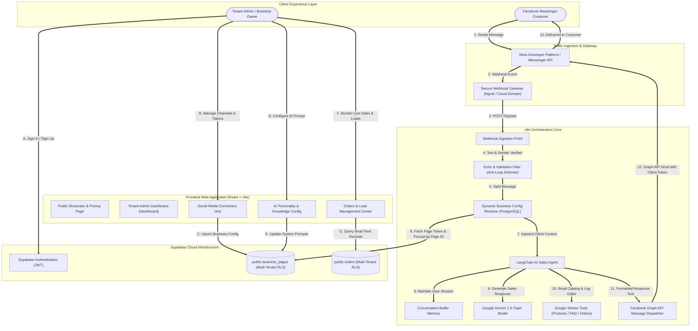
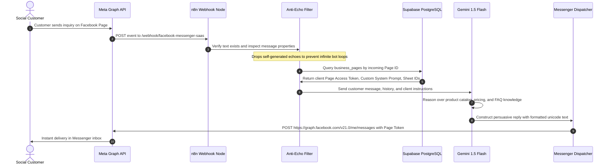

# AutoReply AI: Multi-Tenant Social Media Automation Platform

AutoReply AI is an enterprise-grade, multi-tenant conversational commerce and lead generation SaaS platform. It automates customer engagements, package recommendations, query resolution, and order capture across social channels such as Facebook Messenger using Google Gemini AI, n8n automation workflows, Supabase cloud database, and a modern React with Tailwind CSS interface.

***

## System Architecture

The platform connects customer touchpoints, orchestration pipelines, artificial intelligence models, and multi-tenant data storage into a cohesive ecosystem.

### End to End System Workflow



***

### Multi-Tenant Webhook Execution Sequence

The diagram below outlines the exact lifecycle of every customer interaction, demonstrating how multi-tenant isolation is maintained in real time:



***

## Core Technical Features

### 1. Multi-Tenant Account Architecture
- **Dynamic Credential Binding**: Single webhook endpoint handles unlimited businesses without hardcoded tokens.
- **Data Isolation**: Supabase Row Level Security ensures business accounts, configurations, and customer orders are completely partitioned per authenticated user.
- **Client Configuration Storage**: Each page maintains its own long-lived Page Access Token, custom verify token, AI system prompt, and optional dedicated Google Sheet IDs.

### 2. Intelligent Conversational Engine
- **Powered by Google Gemini 1.5 Flash**: Optimized for fast generation latency and generous free tier allocation (up to 1,500 requests daily).
- **Session Continuity**: Conversation buffer memory preserves multi-turn context keyed by the unique customer sender ID.
- **Enterprise Knowledge Grounding**: AI Agent dynamically accesses product inventories, frequently asked questions, and sales guidelines directly via tool integration.
- **Automated Order Logging**: Confirmed orders, customer phone numbers, package selections, and payment totals are mapped and logged to central databases and spreadsheets.

### 3. Loop and Echo Defense System
- **Anti-Echo Filtering**: Detects and discards Facebook message echo events (`is_echo: true`) and self-sent messages to eliminate recursive bot chatter.
- **Webhook Handshake Automation**: Handles Meta challenge verification (`hub.challenge`) automatically with pre-configured handshake validation.

### 4. Admin Management Dashboard
- **Channel Operations**: Manage Facebook, Instagram, WhatsApp, and LinkedIn touchpoints from a single hub.
- **Interactive Editing**: Modify existing page credentials, tokens, and webhook configurations with real-time updates.
- **Visual Token Assistant**: Step-by-step guidance modal to help tenants generate, debug, and extend long-lived Meta Page Access Tokens.
- **API and Integration Center**: Centralized overview of active webhook URLs, verify tokens, Meta developer credentials, and Google AI Studio keys.
- **Sales Intelligence**: View confirmed customer orders, revenue totals in BDT and USD, and channel-based filters.
- **Single Page Application Navigation**: Clean client-side URL synchronization supporting both landing view and `/dashboard` administrative routes.

***

## Project Directory Layout

```
Social-Media-SaaS/
│
├── frontend/                              # Frontend Web Application (React + Vite + Tailwind)
│   ├── src/
│   │   ├── components/
│   │   │   ├── admin/                     # Dashboard & Management Components
│   │   │   │   ├── AdminNavbar.jsx        # Admin top navigation bar
│   │   │   │   ├── AIAgentConfig.jsx      # System prompt & knowledge editor
│   │   │   │   ├── ApiIntegrations.jsx    # Webhook endpoints & API keys hub
│   │   │   │   ├── DashboardOverview.jsx  # High-level metrics & status cards
│   │   │   │   ├── OrdersManager.jsx      # Channel-filtered orders and leads
│   │   │   │   ├── Sidebar.jsx            # Administrative navigation menu
│   │   │   │   ├── SocialMediaManager.jsx # Multi-platform channel manager
│   │   │   │   └── TestChatSimulator.jsx  # In-browser chat testing simulator
│   │   │   ├── auth/
│   │   │   │   └── AuthModal.jsx          # Supabase Sign Up and Sign In modal
│   │   │   └── landing/                   # Public Landing Page Components
│   │   │       ├── BackToTop.jsx          # Floating smooth scroll button
│   │   │       ├── Features.jsx           # Feature showcase grid
│   │   │       ├── Footer.jsx             # Platform footer & links
│   │   │       ├── Hero.jsx               # Hero conversion section
│   │   │       ├── HowItWorks.jsx         # Process walkthrough cards
│   │   │       ├── Navbar.jsx             # Public header and navigation
│   │   │       └── Pricing.jsx            # Transparent SaaS subscription tiers
│   │   ├── lib/
│   │   │   └── supabaseClient.js          # Supabase client instantiation
│   │   ├── App.jsx                        # Master application & routing controller
│   │   ├── index.css                      # Tailwind style directives
│   │   └── main.jsx                       # React entry point
│   ├── index.html                         # Document template
│   ├── package.json                       # Frontend dependencies
│   ├── tailwind.config.js                 # Design tokens & color system
│   └── vite.config.js                     # Vite build configuration
│
├── database/                              # Database Schemas & Migrations
│   └── schema.sql                         # PostgreSQL schema with tables, indexes, and RLS
│
├── n8n/                                   # Automation Engine Assets
│   └── Facebook_Chat_Automation_SaaS_Dynamic.json  # Multi-tenant n8n workflow
│
├── .env.example                           # Root environment template
├── .gitignore                             # Repository ignore specifications
└── README.md                              # Master architectural documentation
```

***

## Getting Started

### Step 1: Database Initialization (Supabase)

1. Create a project at [supabase.com](https://supabase.com).
2. Open the **SQL Editor**, create a new query, paste the contents of `database/schema.sql`, and run the script.
3. This creates:
   - `public.business_pages`: Stores client Facebook pages, access tokens, AI prompts, and sheet mappings.
   - `public.orders`: Stores captured leads and customer purchases.
   - Row Level Security policies guaranteeing users access only their own records.
4. Retrieve your **Project URL** and **Public Anon Key** from **Project Settings -> API**.

### Step 2: Frontend Setup and Execution

1. Navigate to the frontend directory:
   ```bash
   cd frontend
   ```
2. Create your local environment file:
   ```bash
   cp .env.example .env
   ```
3. Populate `.env` with your Supabase credentials:
   ```env
   VITE_SUPABASE_URL=https://your-project.supabase.co
   VITE_SUPABASE_ANON_KEY=your-publishable-anon-key
   ```
4. Install packages and launch the development server:
   ```bash
   npm install
   npm run dev
   ```
5. Open `http://localhost:3000` to view the public landing page. Click **Get Started** to access the dashboard.

### Step 3: Automation Workflow Setup (n8n)

1. Launch your n8n instance (via Docker or desktop environment).
2. Create a public HTTPS URL using Ngrok:
   ```bash
   ngrok http 5678
   ```
3. In n8n, import `n8n/Facebook_Chat_Automation_SaaS_Dynamic.json`.
4. Configure credentials in n8n:
   - **Postgres Account**: Enter Supabase pooler host (`aws-0-ap-northeast-2.pooler.supabase.com`), port (`6543`), database (`postgres`), user, and password. Enable **Ignore SSL Issues (Insecure)**.
   - **Google Gemini Chat Model**: Connect with a free API key generated from [aistudio.google.com](https://aistudio.google.com). Select model `models/gemini-1.5-flash`.
   - **Google Sheets**: Connect your Google OAuth credential for product catalogs and order sheets.
5. In the top right corner of the n8n canvas, toggle the workflow to **Active (Published)**.

### Step 4: Meta Developer Portal Webhook Connection

1. Visit [developers.facebook.com](https://developers.facebook.com) and navigate to your Meta App.
2. Under **Messenger -> Webhooks**, configure the callback:
   - **Callback URL**: `https://your-ngrok-domain.ngrok-free.app/webhook/facebook-messenger-saas`
   - **Verify Token**: `socialsaas_secret`
3. Click **Verify and Save**.
4. Under **Subscription Fields**, subscribe strictly to `messages` (leave `message_echoes` unchecked).
5. Under **Select a Page to subscribe it to this webhook**, choose your Facebook Business Page and click **Subscribe**.

### Step 5: Connecting Tenant Pages in the Dashboard

1. In the AutoReply AI dashboard (`/dashboard`), navigate to the **Social Media** tab.
2. Click **Connect New Page**.
3. Input your **Page Name**, **Numeric Facebook Page ID**, and **Long-Lived Page Access Token**.
4. Click **Save & Connect Page**.
5. Switch to **AI Agent & Knowledge Config** to personalize the sales tone or connect custom Google Sheet IDs.

Your AI sales assistant is now fully active and will automatically handle customer chats on Messenger.

***

## Security and Privacy Guidelines

- **Zero Secret Commits**: All sensitive items (`.env`, database passwords, private encryption keys) are excluded from source control.
- **Row Level Security**: Database queries originating from authenticated client dashboards can never read or mutate records belonging to other tenants.
- **Long-Lived Token Safety**: Access tokens stored in Supabase are accessed only by authorized tenant sessions and n8n background execution pipelines.

***

## License

This project is released under the MIT License.
